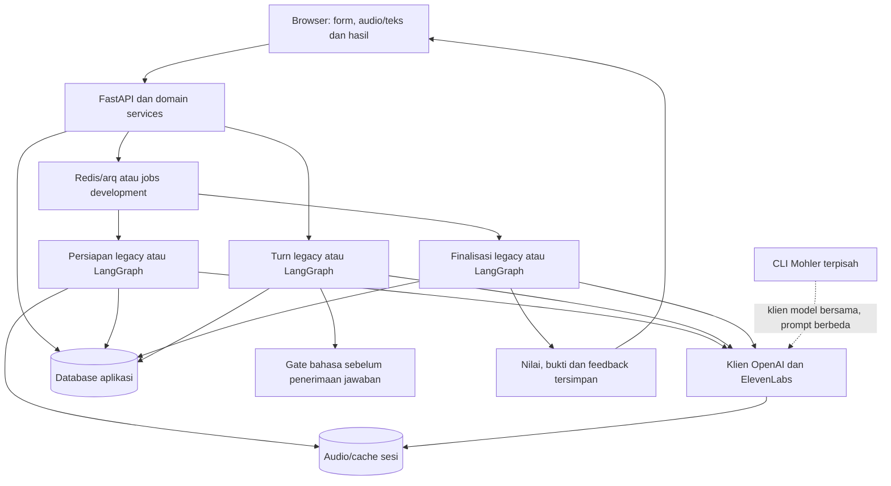

# Arsitektur sistem Preptiva

> Tinjauan dokumentasi: 7 November 2026, baseline `a4369f5`. [Status terkini dan batas verifikasi](current-state.md).

Baseline 7 November 2026: `a85d0da`. Lihat [status terkini](current-state.md) untuk batas implementasi, aktivasi dan verifikasi deployment.

## Komponen

| Layer | Implementasi |
| --- | --- |
| Browser | Jinja2, JavaScript vanilla dan CSS; UI Indonesia/Inggris; ruang wawancara desktop/laptop |
| API | FastAPI, Uvicorn, validasi Pydantic, autentikasi revocable dan pemeriksaan ownership/origin |
| Database | SQLAlchemy async; PostgreSQL untuk deployment, SQLite untuk development |
| Jobs | Redis/arq untuk deployment, asyncio in-process untuk development |
| Orkestrasi | Legacy atau LangGraph `langgraph-v1`, dipin per sesi |
| LLM | OpenAI melalui `app/ai/model_router.py`, model fast/deep dari konfigurasi |
| STT | OpenAI melalui unggahan atau transport realtime; transkrip dapat dikoreksi |
| Gate bahasa | `langdetect` lokal; meminta ulang jika dominan bahasa lain dengan keyakinan tinggi |
| TTS | ElevenLabs; default `eleven_multilingual_v2`, voice per persona, streaming/cache |
| Penyimpanan | Data sesi di DB; audio interviewer/cache per sesi di storage, dengan retensi/penghapusan |
| Hosting | Docker/Compose; panduan Kiri dan konfigurasi proxy tersedia terpisah |

Tidak ada Chart.js, fallback Deepgram, atau browser speech synthesis dalam alur aktif.

## Hubungan komponen

## Modul aktual

- `app/main.py`: lifespan, middleware, router, halaman dan static assets.
- `app/api/`: auth, sessions, voice, dashboard, profile dan privacy.
- `app/services/`: state/turns, lock, event, receipt capture, keamanan HTTP, login dan privasi.
- `app/services/text.py`: cleansing, validasi PDF/teks dan chunking.
- `app/ai/orchestrator.py`: parsing, generasi/adaptasi, respons, evaluasi dan ringkasan.
- `app/ai/memory.py`, `guidebook.py`, `blueprint.py`: konteks dan rencana kompetensi/persona.
- `app/ai/answer_language.py`: gate bahasa; `closing.py`: penutup tanpa Q&A kandidat; `feedback.py`: bahasa dan bentuk feedback akhir.
- `app/ai/scoring.py`, `assessment.py`, `job_rubric.py`: kutipan, indikator, agregasi dan snapshot rubrik.
- `app/graphs/`: preparation, turn, finalization, coordinator, policy, runtime, checkpoint, panel_scoring dan CLI manage.
- `app/worker/tasks.py`, `app/jobs.py`: dispatch dan pekerjaan persiapan/finalisasi.
- `app/storage.py` serta model keamanan/privasi: penyimpanan, penghapusan dan retensi.
- `app/templates/partials/`, `app/static/js/`: halaman dan controller browser.
- `validation/`: perangkat asesor, Mohler, perbandingan eksternal dan baseline orkestrasi.

## Konsistensi dan pemulihan

Database domain menentukan jawaban terkomit dan pertanyaan aktif. Graph menambah checkpoint, ledger operasi, input transkrip dan lease untuk pemulihan. Periksa [operasi LangGraph](langgraph-orchestration.md) untuk thread, operasi ambigu dan retry operator. Transaksi/checkpoint bukan jaminan panggilan provider tepat sekali.

`language_retry` tidak menerima jawaban penilaian atau GraphTurnInput dan tidak memajukan giliran. STT yang sudah dijalankan tetap dapat ditagih. Audio, teks dan koreksi transkrip melewati kebijakan bahasa yang sama. Deteksi tidak pasti tidak otomatis ditolak.

Interupsi tab/offline/device/reload menghentikan pertanyaan. Retry mengulang dengan waktu penuh; Next melewati tanpa skor. Panggilan provider yang terlambat tidak boleh menghidupkan percobaan lama.

## Hasil, bahasa dan batas asesmen

Wawancara memakai `script.settings.language`; feedback memakai `feedback_language` yang dipilih dari UI saat sesi dibuat. Rubrik/engine/bobot dipin, bukti asli tidak diterjemahkan. Penutup mengakhiri wawancara tanpa mengajak kandidat bertanya; finalisasi otomatis menghasilkan hasil. Bukti kurang dikecualikan dari agregat dan skor null bukan nol.

Lihat [pipeline](ai-pipeline.md), [hasil](results.md), [API](api.md), [bahasa](languages-and-personas.md), [database](database.md), [privasi](security-and-privacy.md). Benchmark Mohler tidak mengubah skor sesi dan belum memvalidasi rubrik wawancara.
