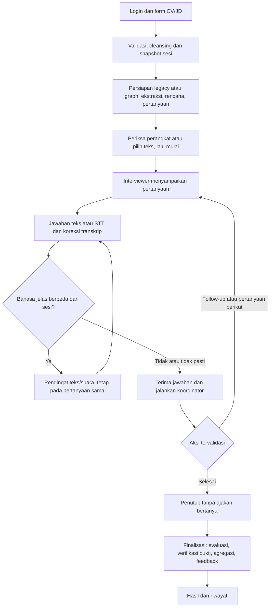

# Status dokumentasi terkini — 7 November 2026

Baseline kode: `a4369f5` di `origin/main`. Tanggal ini adalah tinjauan dokumentasi, bukan bukti bahwa deployment publik sudah diperbarui. Nilai konfigurasi privat `.env` tidak disalin ke dokumentasi.

## Ringkasan implementasi

| Area | Status terkini | Referensi |
| --- | --- | --- |
| Orkestrasi | Legacy dan LangGraph tersedia. Default kode `ORCHESTRATION_ENGINE=legacy`; engine/version dipin per sesi. Aktivasi deployment harus dicek terpisah | [LangGraph](langgraph-orchestration.md) |
| Panel | HR/User/Manager, konteks bersama terbatas, routing tervalidasi, follow-up milik penanya utama | [Panel](panel-implementation.md) |
| Bahasa | UI Indonesia/Inggris; `language` untuk wawancara, `feedback_language` untuk hasil dari pilihan platform saat sesi dibuat | [Bahasa](languages-and-personas.md) |
| Bahasa jawaban berbeda | Deteksi lokal konservatif; `language_retry` meminta ulang pada pertanyaan sama, tanpa skor, tambahan follow-up atau penutupan | [API](api.md) |
| Penutup | Tidak ada fase kandidat bertanya kepada panel. Slot lama `candidate_questions` diganti `reflection` untuk sesi 5/7 pertanyaan; sesi 3 berakhir pada `decision`; penutup menjelaskan penilaian dan hasil | [Pipeline](ai-pipeline.md) |
| Hasil | Otomatis setelah finalisasi. Jawaban/feedback terbuka; disclosure ikut print/PDF. Skor null bukan nol | [Hasil](results.md) |
| Dokumen | Cleansing dan chunking CV/JD; teks asli dipertahankan sesuai kebutuhan sumber bukti | [Pemrosesan](document-processing.md) |
| Provider | OpenAI LLM/STT; ElevenLabs TTS, default Multilingual v2. Tidak ada fallback Deepgram/OpenAI TTS/browser speech | [Environment](env.md) |
| Validasi rubrik | Acuan berbasis referensi dan pemeriksaan teknis tersedia; validasi manusia EM belum tersedia, `validated: false` | [Asesmen](assessment-reference.md) |
| Mohler | Unduhan 2.442 jawaban, 214 ketidaksesuaian rata-rata ditandai, pilot 50 siap; run model belum dilakukan pada baseline ini | [Mohler](mohler-benchmark.md) |
| Privasi | Sesi login revocable, penghapusan/retensi, data graph ikut cakupan penghapusan | [Keamanan](security-and-privacy.md) |

Jawaban asli, kutipan dan indikator snapshot tidak diterjemahkan sebagai bukti baru. Mengganti bahasa UI setelah sesi dimulai tidak menerjemahkan hasil AI lama. Gate bahasa adalah pemeriksaan sebelum penerimaan jawaban, bukan pengurangan skor kompetensi.

## Alur aktif

Interupsi browser tetap memakai Retry/Next; resume graph tidak menyalakan mikrofon otomatis. Inspector Studio localhost sudah tersedia melalui Agent Server metadata-only dan demo sintetis terisolasi. UI Studio memerlukan konfigurasi environment/akun LangSmith; tidak otomatis muncul di halaman Preptiva. Lihat [perintah Studio](langgraph-orchestration.md#studio-lokal-dan-sesi-demonstrasi).

## Bukti pengujian yang terakhir dijalankan untuk perbaikan bahasa

- `test_answer_language.py`: 7 tes lulus, termasuk legacy/graph, JSON/NDJSON, audio dan pengiriman ulang bahasa yang benar.
- `test_system.py`: 50 tes lulus setelah integrasi main dan perbaikan bahasa.
- Controller JavaScript: lulus, termasuk pengingat berulang, pertanyaan tetap sama, tanpa finish atau tambahan retry.
- Pemeriksaan `git diff --check` lulus sebelum push `a85d0da`.

Pengujian tersebut memakai provider tiruan, bukan pengukuran akurasi bahasa semua kandidat. Angka tes pada entri changelog lama adalah hasil pada commit masing-masing, bukan jumlah suite saat ini. Tinjauan Markdown ini tidak menjalankan model berbayar dan tidak mengonfirmasi deployment.

## Cara memakai dokumentasi

[README aplikasi](../README.md) untuk mulai menjalankan; [indeks dokumen](README.md) untuk navigasi. Panduan aktif mengikuti kode baseline ini. `docs/superpowers/plans/` memuat rencana historis; tugas yang tertulis di sana tidak berarti belum diimplementasikan atau harus dikerjakan ulang. Changelog mempertahankan urutan sejarah. Rubrik di antara penanda runtime tidak diubah oleh pembaruan dokumentasi ini.

## Integrasi frontend dan Studio dari main terbaru

`f90b69a` membawa frontend terbaru dan validasi JD minimal lima kata (maksimal 40.000 karakter). Form profil/setup memakai unggahan PDF atau CV tersimpan; kompatibilitas teks CV tetap ada pada API. Main `a4369f5` juga membawa inspeksi graph metadata-only melalui Studio, demo database terisolasi dan CLI list/inspect. Panduan operasional upstream dipertahankan; ketersediaan kode tidak membuktikan Studio/account atau deployment publik telah diperiksa pada tinjauan ini.
