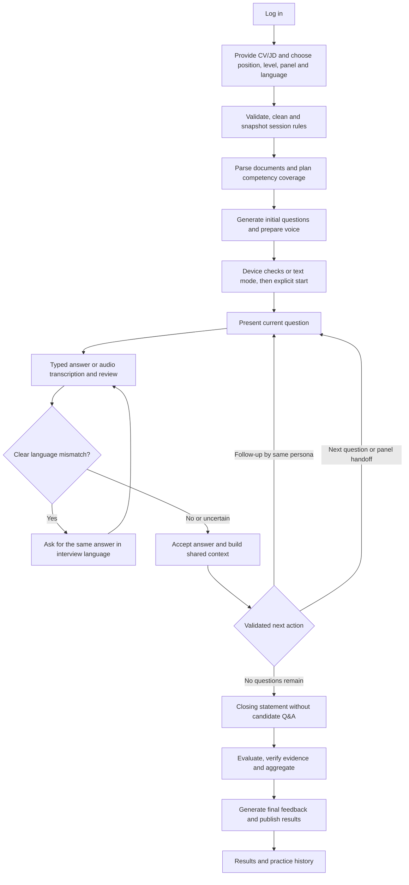

# Preptiva End-to-End Flow

> Reviewed against `a4369f5`, 7 November 2026. See [current implementation and verification scope](current-state.md); deployment activation is separate.

Updated 7 November 2026 against `a85d0da`. Both legacy and optional LangGraph workflows exist. Engine selection is pinned per session; default code configuration remains legacy. See the separate [architecture](langgraph-target-architecture.md).

## What each stage produces

1. FastAPI validates the form and saves rubric, weights, limits, engine and language settings.
2. Text processing cleans documents and chunks long content; OpenAI extracts relevant information with source references.
3. Preparation builds coverage and panel slots, creates initial questions and prepares ElevenLabs audio.
4. The candidate explicitly starts and answers by text or audio. OpenAI STT produces transcripts; corrections preserve the original text.
5. Local language detection checks clear Indonesian/English mismatch. A mismatch returns a retry reminder in text/audio before the answer becomes an assessment unit. The same question remains active.
6. Legacy or LangGraph orchestration uses bounded conversation context and source-linked evidence to select a follow-up, next question or closing. Code enforces persona scope and budgets.
7. A final reflection question can still require a candidate answer. The separate closing never invites questions and leads to automatic finalization.
8. Evaluation compares accepted answers with the saved rubric. Quotes and structured indicators are checked. Missing evidence is not automatically a low score.
9. Aggregation uses measured competencies and the session's policy. Graph panel assessments preserve initial ratings and advisory review instead of forcing human-like consensus.
10. Final explanations and practice actions use the platform language saved at creation. Original answers/quotes keep their language. The browser displays scores, coverage, explanations and feedback automatically.

## Recovery branches

- Microphone denied or TTS failure: continue using supported text controls.
- Browser hidden/offline/device loss/reload: stop the active question; Retry repeats with a full timer and Next skips without a competence score.
- Language mismatch: ask for a new answer on the same question; no additional follow-up/recording-retry charge. Already-used STT may still incur provider cost.
- Worker failure: reuse completed recorded operations and reconcile domain state. Ambiguous provider completion needs operator acknowledgment.
- Failed evaluation: retain answers and allow evaluation retry.
- Reconnect/duplicate requests: preserve accepted answers and avoid duplicate transitions.

## Developer testing is separate

Mohler download → quality checks → 50 blind pilot inputs and separate human labels → explicit paid scorer run → report. Download/preparation are complete on the source workspace; model evaluation has not been run at this baseline. This benchmark never runs automatically after every user interview and does not establish validity of the production interview rubric.

A localhost Studio integration is now available for metadata-only inspection of recorded graphs and an isolated synthetic demo; follow the graph operations guide for environment and account setup. It does not add a graph page to the public Preptiva UI. The diagram above explains flow; it is not a trace of a real session.
