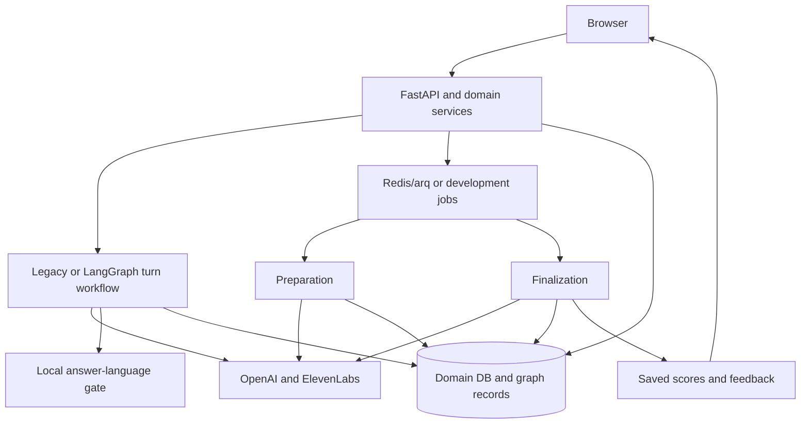

# Preptiva Architecture: LangGraph Integration

> Reviewed against `a4369f5`, 7 November 2026. See [current implementation and verification scope](current-state.md); deployment activation is separate.

Updated 7 November 2026 against `a85d0da`. This filename preserves the original design reference. LangGraph is now implemented as an optional engine; not every design idea is implemented. The code default is `ORCHESTRATION_ENGINE=legacy`. Deployment activation must be checked separately. See [current status](current-state.md) and [graph operations](langgraph-orchestration.md).

## Components and responsibilities

| Component | Responsibility |
| --- | --- |
| Browser, Jinja2, JavaScript and CSS | Setup, recording/text input, transcript review, recovery and results |
| FastAPI | Authentication, ownership, session APIs and audio transport |
| OpenAI | CV/JD extraction, questions, reasoning, assessment and STT |
| ElevenLabs | Interviewer speech; default Multilingual v2 and separate persona voices |
| LangGraph or legacy orchestration | Preparation, turn processing and finalization |
| SQLAlchemy and PostgreSQL/SQLite | Domain state, accepted answers and persisted graph records |
| Redis/arq | Deployment background jobs; development can use in-process jobs |
| Local language detection | Request a retry on clear Indonesian/English mismatch before answer acceptance |
| Separate Mohler CLI | Academic answer-scoring benchmark, not production rubric validation |

## Workflow boundaries

Preparation cleans and parses CV/JD, builds persona coverage, generates questions and prepares audio. The turn graph accepts a transcript, builds shared source-linked context, validates coordinator decisions, prepares the next utterance and commits one transition. Finalization produces independent scoped initial AI ratings, checks evidence, optionally reviews disagreements, aggregates measured scores and saves feedback.

Checkpoints, an operation ledger and database leases support recovery. Domain answers and active questions remain authoritative. Uncertain paid calls require explicit operator handling; exactly-once provider execution is not guaranteed.

## Language and end-of-session policy

Interview language controls questions and STT context. Feedback language is saved from the platform language at creation. Original transcripts and evidence are preserved. Clear wrong-language answers produce `language_retry`: same question, no score, no extra follow-up, no finish. Very short or uncertain language is not rejected automatically.

There is no candidate Q&A phase. The former candidate_questions slot uses reflection in 5/7-question sessions; 3-question sessions end with a decision slot; the closing states that the interview is finished and results will be prepared. Hidden tab/offline/reload still stops the question and requires Retry/Next. Graph recovery does not restart recording.

## Results and remaining boundaries

Results appear automatically after finalization; transcripts and feedback are expanded and printable. Null scores mean no measurable weighted evidence, not zero. Rubrics remain unvalidated for hiring. Mohler uses a separate prompt and has no model-run metrics yet.

Main now includes a localhost Agent Server integration with three metadata-only Studio inspectors, plus an isolated synthetic demo. Studio requires its separate environment and LangSmith account/key. It inspects recorded operations without rerunning production providers. An embedded viewer in the public Preptiva UI is still separate work. See the graph operations guide for setup and data-handling limits.
